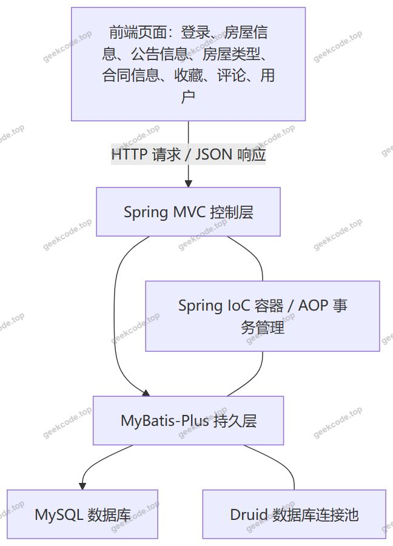
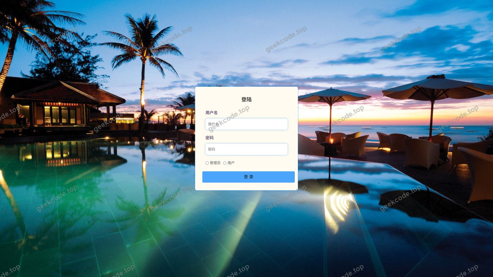
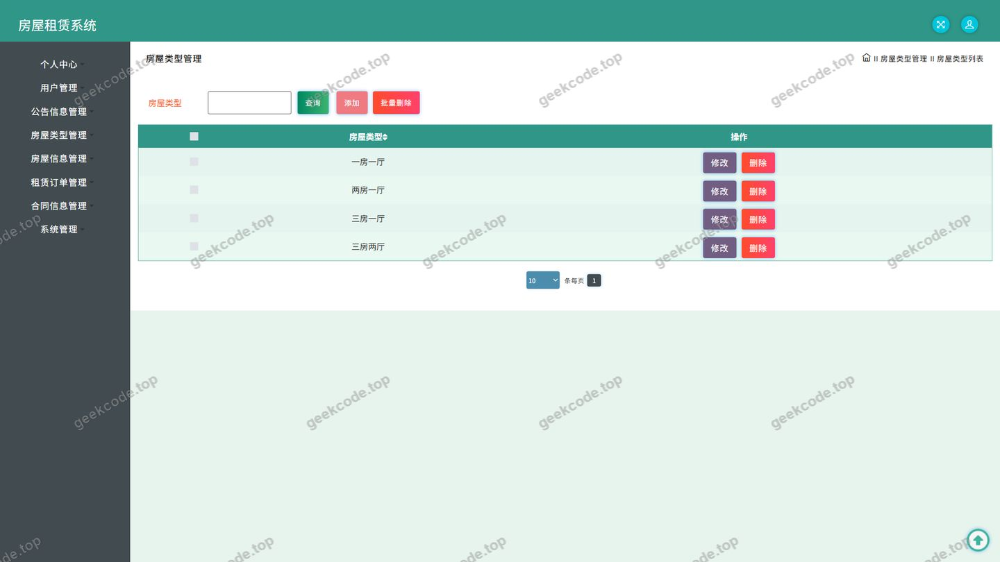
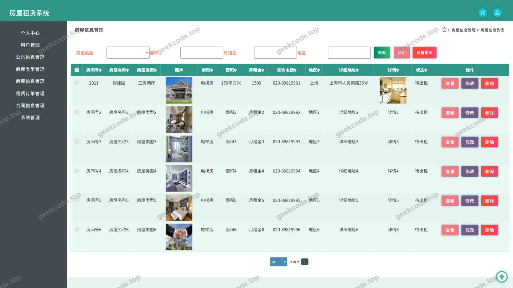
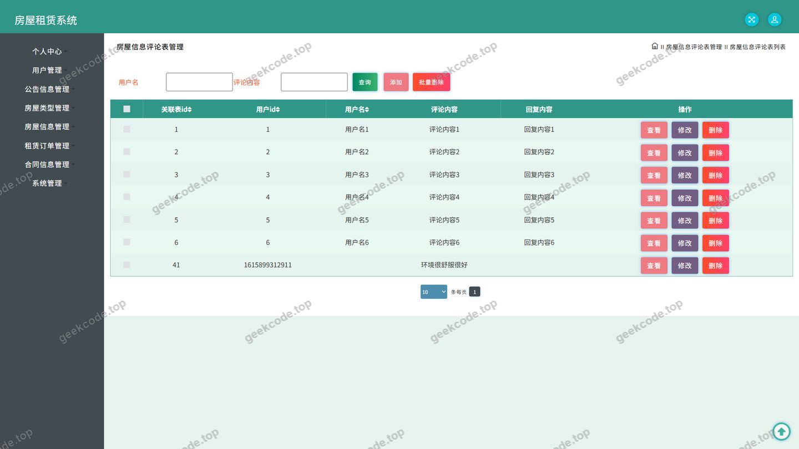
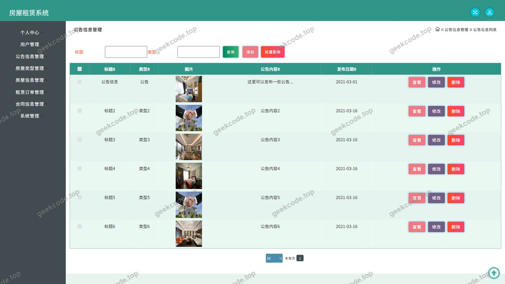
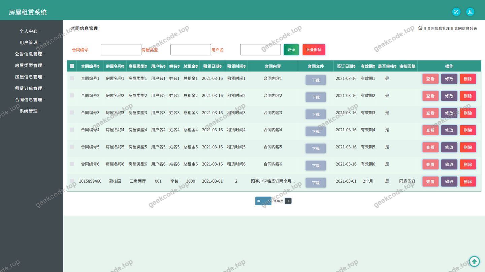
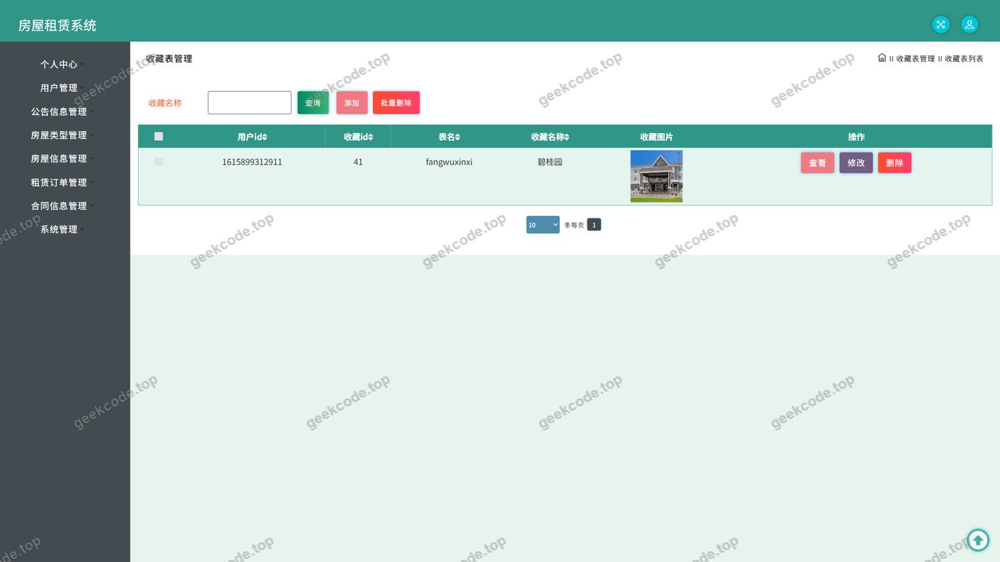
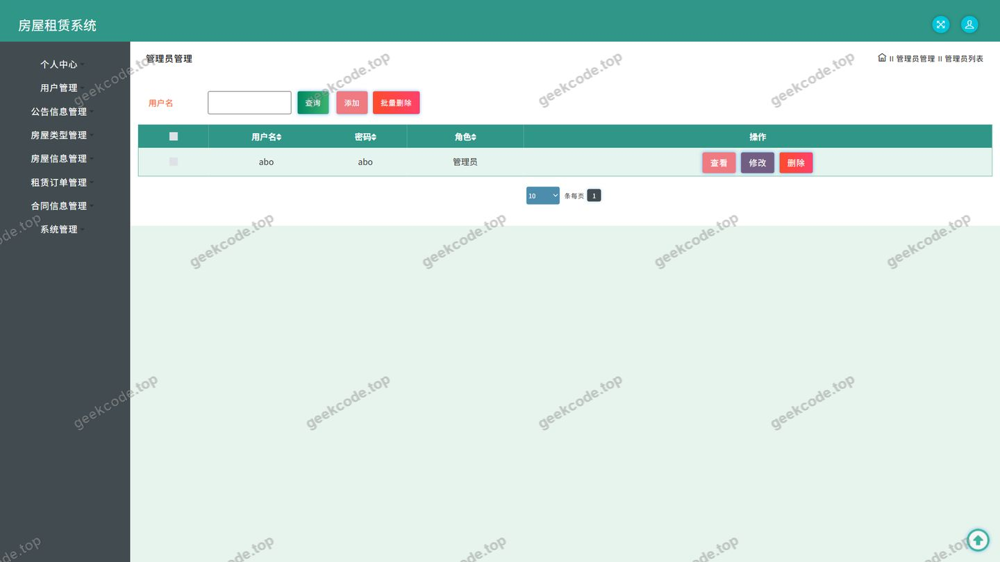
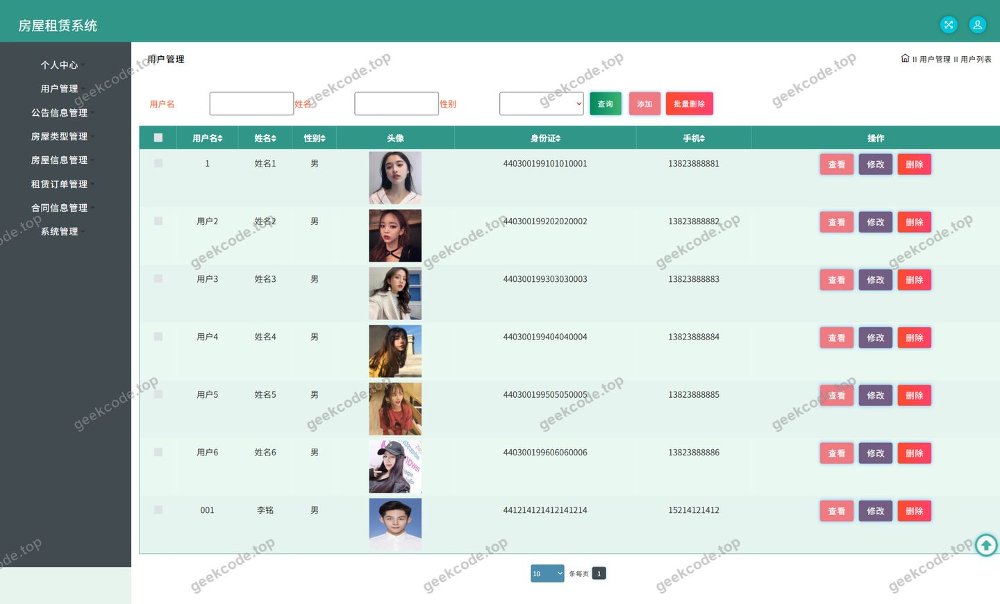

# java毕业设计ssm房屋租赁系统计算机毕业设计

> 🎓 **计算机毕业设计 · java毕业设计ssm房屋租赁系统计算机毕业设计**
>
> 本仓库只放**项目介绍 + 运行截图**（截图是站点带水印的原图，存在仓库 `images/` 里）。
>
> 👉 **完整可运行源码 / 数据库脚本 / 部署文档：[点我获取](https://geekcode.top/archives/java%E6%AF%95%E4%B8%9A%E8%AE%BE%E8%AE%A1ssm%E6%88%BF%E5%B1%8B%E7%A7%9F%E8%B5%81%E7%B3%BB%E7%BB%9F%E8%AE%A1%E7%AE%97%E6%9C%BA%E6%AF%95%E4%B8%9A%E8%AE%BE%E8%AE%A1?utm_source=github)**
>
> 💬 咨询微信：**ir9372**　|　🌐 更多项目：[极客代码 geekcode.top](https://geekcode.top/?utm_source=github)
>
> 📌 项目详情页：<https://geekcode.top/archives/java%E6%AF%95%E4%B8%9A%E8%AE%BE%E8%AE%A1ssm%E6%88%BF%E5%B1%8B%E7%A7%9F%E8%B5%81%E7%B3%BB%E7%BB%9F%E8%AE%A1%E7%AE%97%E6%9C%BA%E6%AF%95%E4%B8%9A%E8%AE%BE%E8%AE%A1?utm_source=github>

<table><td width="230" align="center"> <b>扫码加微信 ir9372</b></td><td valign="middle">📦 源码 = 项目介绍 + 全部运行截图 + 数据库 + 部署文档 👉 点上方任意截图，直接跳到 <b>极客代码 geekcode.top</b> 详情页</td></table>

---

<h1>java毕业设计_ssm房屋租赁系统_计算机毕业设计</h1>
<h2>项目概述</h2>

房屋租赁系统是一套面向房屋租赁业务的信息化管理平台，采用纯接口（pure-api）形式构建，后端基于 Spring、Spring MVC 与 MyBatis-Plus 技术体系，使用 Druid 作为数据库连接池，通过 REST 风格接口向前端页面输出 JSON 数据。

系统的核心业务涵盖房屋信息与房屋类型的发布和查询、公告信息展示、房屋信息评论互动、用户收藏、合同信息管理以及租赁订单管理等环节；个人中心提供个人中心与我的收藏两个入口，前台导航提供公告信息与房屋信息两个主要栏目。

项目适用于计算机专业毕业设计选题、教学演示，以及中小型房屋租赁业务的房源、合同、订单一体化信息管理场景。使用者主要分为两类：一是管理人员，负责房源、公告、合同、订单、评论与用户数据的维护；二是普通用户，负责浏览房源、发表评论、收藏房源、查看公告与合同订单信息。

<h2>技术架构</h2>

系统整体采用经典的 SSM 分层架构，后端负责业务逻辑处理与数据持久化，前端页面通过 HTTP 请求调用后端接口并渲染数据，前后端之间以 JSON 作为数据交互格式。

<strong>控制层</strong>：由 Spring MVC 承担请求分发与响应封装，项目中共有 12 个控制器，分别为 CommonController、ConfigController、DiscussfangwuxinxiController、FangwuleixingController、FangwuxinxiController、FileController、GonggaoxinxiController、HetongxinxiController、StoreupController、UserController、YonghuController、ZulindingdanController，分别对应公共能力、配置、房屋信息评论、房屋类型、房屋信息、文件、公告信息、合同信息、收藏、用户、用户信息、租赁订单等业务域。

<strong>持久层</strong>：采用 MyBatis-Plus 完成对象与关系数据库之间的映射，承担房源、类型、公告、合同、订单、评论、收藏等数据的读写。

<strong>基础支撑</strong>：Spring 提供 IoC 容器与声明式事务能力，spring-aop、spring-tx、spring-jdbc、spring-beans、spring-context、spring-context-support、spring-core、spring-web、spring-webmvc 构成完整的框架依赖集合；Druid 提供数据库连接池能力；JUnit 用于单元测试。

<strong>数据库设计要点</strong>：从控制器命名可以判断，系统围绕用户、房屋信息、房屋类型、公告信息、合同信息、租赁订单、房屋信息评论、收藏、配置等实体组织数据。其中房屋类型与房屋信息之间、房屋信息与评论之间、用户与收藏及订单之间构成主要的业务关联。根据现有信息，具体的表结构、字段定义与索引设计无法确定。

<strong>技术选型理由</strong>：Spring 与 Spring MVC 生态成熟、组件边界清晰，便于按业务模块划分控制器；MyBatis-Plus 在保留原生 SQL 控制力的同时提供通用 CRUD 与条件构造能力，适合毕业设计这类以单表与简单关联查询为主的场景；Druid 具备连接复用与运行状态监控能力，便于观察数据库连接使用情况；JUnit 保障核心逻辑的可测试性。

<h2>功能模块</h2>

系统的功能以接口形式对外提供，前端页面依据截图功能列表包含登录、房屋信息、房屋信息评论、房屋类型、公告信息、合同信息、收藏、用户等页面，个人中心提供个人中心与我的收藏入口。系统未配置独立的后台前端路由，管理端能力由各控制器提供的接口承载。

<h3>前台用户端</h3>
<table>
<thead>
<tr>
<th>模块</th>
<th>对应控制器</th>
<th>功能描述</th>
</tr>
</thead>
<tbody><tr>
<td>登录</td>
<td>UserController / YonghuController</td>
<td>提供系统登录页面的账号密码校验与身份识别能力</td>
</tr>
<tr>
<td>公告信息</td>
<td>GonggaoxinxiController</td>
<td>展示系统发布的公告信息，前台导航中的独立栏目</td>
</tr>
<tr>
<td>房屋信息</td>
<td>FangwuxinxiController</td>
<td>展示房源列表与房源详情，前台导航中的核心栏目</td>
</tr>
<tr>
<td>房屋信息评论</td>
<td>DiscussfangwuxinxiController</td>
<td>针对具体房源发表评论并展示已有评论内容</td>
</tr>
<tr>
<td>房屋类型</td>
<td>FangwuleixingController</td>
<td>展示房屋类型数据，用于房源按类型分类浏览</td>
</tr>
<tr>
<td>收藏</td>
<td>StoreupController</td>
<td>对房源进行收藏，对应个人中心的&quot;我的收藏&quot;入口</td>
</tr>
<tr>
<td>合同信息</td>
<td>HetongxinxiController</td>
<td>展示租赁合同相关信息</td>
</tr>
<tr>
<td>租赁订单</td>
<td>ZulindingdanController</td>
<td>承载租赁订单相关数据的提交与查询</td>
</tr>
<tr>
<td>个人中心</td>
<td>UserController / YonghuController</td>
<td>个人信息的查看与维护，是个人中心模块的数据入口</td>
</tr>
<tr>
<td>文件</td>
<td>FileController</td>
<td>提供图片等文件的上传与访问能力，支撑房源等业务的数据展示</td>
</tr>
<tr>
<td>通用能力</td>
<td>CommonController</td>
<td>承载跨业务模块的公共接口能力</td>
</tr>
<tr>
<td>配置</td>
<td>ConfigController</td>
<td>承载系统参数与配置类数据的读取能力</td>
</tr>
</tbody></table>
<h3>后台管理端</h3>

系统未提供后台前端路由，管理端以控制器接口作为数据维护入口，涵盖以下业务域：

<table>
<thead>
<tr>
<th>模块</th>
<th>对应控制器</th>
<th>功能描述</th>
</tr>
</thead>
<tbody><tr>
<td>用户管理</td>
<td>UserController</td>
<td>对系统用户账号数据进行维护</td>
</tr>
<tr>
<td>用户信息管理</td>
<td>YonghuController</td>
<td>对用户信息数据进行维护</td>
</tr>
<tr>
<td>房屋信息管理</td>
<td>FangwuxinxiController</td>
<td>对房源数据进行新增、修改、删除与查询</td>
</tr>
<tr>
<td>房屋类型管理</td>
<td>FangwuleixingController</td>
<td>对房屋类型数据进行维护，为房源提供分类依据</td>
</tr>
<tr>
<td>公告信息管理</td>
<td>GonggaoxinxiController</td>
<td>对系统公告进行发布与维护</td>
</tr>
<tr>
<td>合同信息管理</td>
<td>HetongxinxiController</td>
<td>对租赁合同数据进行维护</td>
</tr>
<tr>
<td>租赁订单管理</td>
<td>ZulindingdanController</td>
<td>对租赁订单数据进行维护</td>
</tr>
<tr>
<td>房屋信息评论管理</td>
<td>DiscussfangwuxinxiController</td>
<td>对房源评论数据进行查看与维护</td>
</tr>
<tr>
<td>收藏管理</td>
<td>StoreupController</td>
<td>对用户收藏记录进行查看与维护</td>
</tr>
<tr>
<td>文件管理</td>
<td>FileController</td>
<td>对上传文件的接收与存储进行管理</td>
</tr>
<tr>
<td>配置管理</td>
<td>ConfigController</td>
<td>对系统配置数据进行维护</td>
</tr>
<tr>
<td>公共接口</td>
<td>CommonController</td>
<td>提供跨模块的公共数据能力</td>
</tr>
</tbody></table>
<h2>用户角色与权限</h2>

系统包含两类账号体系，分别由 UserController 与 YonghuController 承载。

<strong>管理员</strong>

<ul>
<li>用户管理：通过 UserController 维护系统用户账号数据。</li>
<li>用户信息管理：通过 YonghuController 维护用户信息数据。</li>
<li>房屋信息管理：通过 FangwuxinxiController 管理房源数据，是系统的核心业务对象。</li>
<li>房屋类型管理：通过 FangwuleixingController 维护房屋类型数据。</li>
<li>公告信息管理：通过 GonggaoxinxiController 发布与维护公告。</li>
<li>合同信息管理：通过 HetongxinxiController 维护租赁合同数据。</li>
<li>租赁订单管理：通过 ZulindingdanController 维护租赁订单数据。</li>
<li>房屋信息评论管理：通过 DiscussfangwuxinxiController 查看与维护房源评论。</li>
<li>收藏管理：通过 StoreupController 查看与维护收藏记录。</li>
<li>文件管理：通过 FileController 完成文件上传与访问。</li>
<li>配置管理：通过 ConfigController 维护系统配置数据。</li>
<li>公共接口：通过 CommonController 使用跨模块公共能力。</li>
</ul>

<strong>普通用户（租户）</strong>

<ul>
<li>登录：通过登录页面完成身份识别后进入系统。</li>
<li>公告信息：浏览 GonggaoxinxiController 提供的公告信息，该栏目位于前台导航菜单中。</li>
<li>房屋信息：浏览与查询 FangwuxinxiController 提供的房源信息，该栏目位于前台导航菜单中。</li>
<li>房屋类型：查看 FangwuleixingController 提供的房屋类型数据。</li>
<li>房屋信息评论：通过 DiscussfangwuxinxiController 针对房源发表评论并查看评论内容。</li>
<li>收藏：通过 StoreupController 收藏房源，并在个人中心的&quot;我的收藏&quot;入口中查看。</li>
<li>个人中心：通过 UserController 与 YonghuController 查看和维护个人信息，该入口位于个人中心菜单中。</li>
<li>合同信息：查看 HetongxinxiController 提供的合同信息。</li>
<li>租赁订单：通过 ZulindingdanController 提交与查看租赁订单数据。</li>
</ul>
<h2>项目特色与创新点</h2>
<ol>
<li>
<strong>业务闭环完整</strong>：系统覆盖从房源浏览、评论互动、收藏、租赁下单到合同信息的完整链路，房屋信息、房屋类型、租赁订单、合同信息之间形成业务衔接，而非单一的数据增删改查演示。

</li>
<li>
<strong>接口化设计，职责边界清晰</strong>：项目采用纯接口形式构建，12 个控制器按业务域逐一拆分，房屋信息、房屋类型、公告信息、合同信息、租赁订单、评论、收藏、用户、配置、文件各自独立，便于按模块理解与二次开发。

</li>
<li>
<strong>个人中心与前台导航双入口组织</strong>：前台以公告信息、房屋信息作为主要浏览栏目，个人中心以个人中心、我的收藏作为用户自有数据入口，浏览行为与个人数据管理相互分离，符合租赁类系统的实际使用习惯。

</li>
<li>
<strong>评论与收藏增强用户参与度</strong>：通过房屋信息评论与收藏机制，用户在浏览房源之外还能产生互动数据与个性化记录，为房源热度与用户偏好提供数据基础。

</li>
<li>
<strong>技术组合贴近教学与工程实践</strong>：Spring + Spring MVC + MyBatis-Plus + Druid 的组合覆盖了 IoC、AOP、事务、ORM 映射、连接池等核心知识点，同时 JUnit 依赖为编写单元测试提供了基础条件，适合作为毕业设计的学习与扩展起点。

</li>
</ol>
<h2>部署环境</h2>
<table>
<thead>
<tr>
<th>类别</th>
<th>要求</th>
</tr>
</thead>
<tbody><tr>
<td>JDK</td>
<td>需安装 JDK，用于运行基于 Spring 框架体系的后端服务</td>
</tr>
<tr>
<td>数据库</td>
<td>需安装 MySQL，并导入系统所需的数据库结构与初始数据</td>
</tr>
<tr>
<td>构建工具</td>
<td>需使用 Maven，项目依赖以坐标形式声明，包括 junit、spring-core、spring-context、spring-context-support、spring-tx、spring-aop、spring-beans、spring-jdbc、spring-web、spring-webmvc、MyBatis-Plus、Druid</td>
</tr>
<tr>
<td>Web 容器</td>
<td>需具备 Servlet 容器（如 Tomcat）以承载 Spring MVC 的请求分发</td>
</tr>
<tr>
<td>连接池</td>
<td>由 Druid 提供数据库连接池能力，需在配置中正确填写数据库连接参数</td>
</tr>
<tr>
<td>前端运行环境</td>
<td>项目为纯接口后端，不包含前端构建流程，运行时不依赖 Node.js 环境，也不涉及微信开发者工具</td>
</tr>
<tr>
<td>测试环境</td>
<td>依赖 JUnit，可在开发阶段运行单元测试</td>
</tr>
</tbody></table>

启动前需完成以下准备工作：创建 MySQL 数据库并导入表结构与初始数据，配置数据库连接地址、账号与密码，确认 JDK 与 Maven 环境变量配置正确，随后编译打包并部署到 Servlet 容器中运行，通过接口地址访问系统各项业务能力。

<h2>五、技术特性</h2>
<ul>
<li>使用 MyBatis-Plus 简化数据访问层开发</li>
</ul>
<h2>六、功能模块截图</h2>
<h3>后台管理端</h3>
<h4>页面-登录</h4>

<h4>页面-房屋类型</h4>

<h4>页面-房屋信息</h4>

<h4>页面-房屋信息评论</h4>

<h4>页面-公告信息</h4>

<h4>页面-合同信息</h4>

<h4>页面-收藏</h4>

<h4>页面-用户</h4>

<h4>页面-用户</h4>

---

## 获取完整源码

| 项目 | 说明 |
| --- | --- |
| 项目名 | java毕业设计ssm房屋租赁系统计算机毕业设计 |
| 运行截图 | 本文 10 张（站点带水印原图，仓库 `images/` 目录） |
| 完整源码 | [https://geekcode.top/archives/java%E6%AF%95%E4%B8%9A%E8%AE%BE%E8%AE%A1ssm%E6%88%BF%E5%B1%8B%E7%A7%9F%E8%B5%81%E7%B3%BB%E7%BB%9F%E8%AE%A1%E7%AE%97%E6%9C%BA%E6%AF%95%E4%B8%9A%E8%AE%BE%E8%AE%A1?utm_source=github](https://geekcode.top/archives/java%E6%AF%95%E4%B8%9A%E8%AE%BE%E8%AE%A1ssm%E6%88%BF%E5%B1%8B%E7%A7%9F%E8%B5%81%E7%B3%BB%E7%BB%9F%E8%AE%A1%E7%AE%97%E6%9C%BA%E6%AF%95%E4%B8%9A%E8%AE%BE%E8%AE%A1?utm_source=github) |
| 咨询微信 | **ir9372**（备注：jingpin-yuanma） |
| 更多项目 | [极客代码 geekcode.top](https://geekcode.top/?utm_source=github) |

> 需要源码、部署、改配置、跑不起来等问题，加微信 ir9372 沟通，说明项目名即可。
